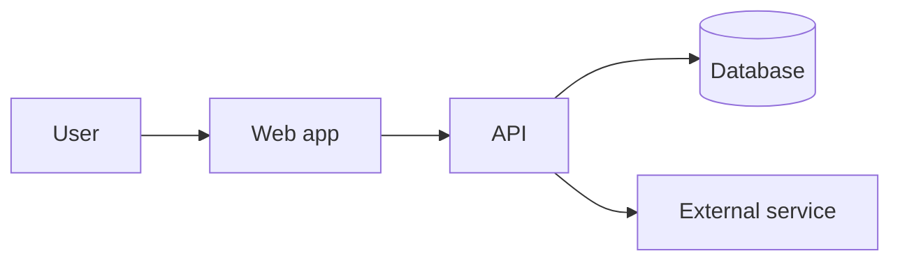

# Architecture Overview

> Describe the system as it **is**, not as it was planned. Planned changes go in specs / ADRs.

## 1. System context
<!-- Who/what talks to the system. A diagram (Mermaid renders on GitHub/GitLab) beats paragraphs. -->

## 2. Components
| Component | Responsibility | Tech | Repo path | Owner |
|---|---|---|---|---|
| | | | | |

## 3. Key flows
<!-- The 2–5 flows that matter most (e.g. sign-up, checkout, nightly sync). Sequence diagram or numbered steps. -->

### Flow: <name>
1. …

## 4. Data
| Store | What lives there | Source of truth for | Retention | PII? |
|---|---|---|---|---|
| | | | | |

Core entities and relationships: <!-- link to schema file / ERD rather than copying -->

**API contracts:** the authoritative machine-readable definitions (OpenAPI / protobuf / event schemas) live at `…`. Link to them; don't copy endpoint lists here.

## 5. Integrations
| System | Direction | Protocol | Auth | Failure behaviour | Owner / contact |
|---|---|---|---|---|---|
| | in / out | REST / queue / … | | retries? degrade? | |

## 6. Cross-cutting concerns
- **AuthN / AuthZ:**
- **Config & secrets:** (see `06-operations/environments.md`)
- **Logging / tracing / metrics:**
- **Error handling convention:**
- **Background jobs / scheduling:**

## 7. Quality attributes & limits
<!-- Known limits: max throughput, largest tenant, single points of failure. -->

## 8. Key decisions
| ADR | Decision | Status |
|---|---|---|
| `ADR-0001` | | accepted |

## 9. Known tech debt
| Item | Impact | Plan / ticket |
|---|---|---|
| | | |
