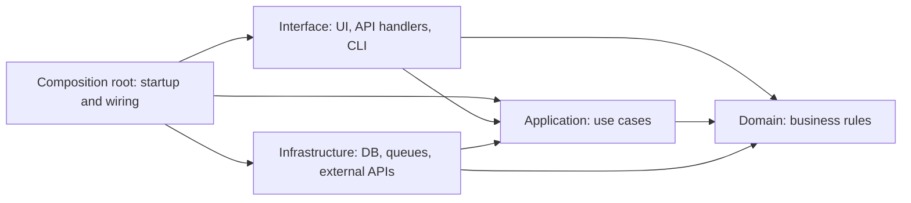

# Implementation Conventions

> Everything a developer or AI agent needs to make a correct change on day one.

## 1. Repo map
```
/src/…        ← what lives here
/tests/…      ← unit / integration split
/scripts/…    ← one-off and ops scripts
/kb/…         ← this knowledge base
```
Generated / do-not-edit paths: see [`AGENTS.md §3`](../../AGENTS.md).

## 2. Setup
Day-to-day commands (install, run, test, lint) are canonical in [`AGENTS.md §3`](../../AGENTS.md) — don't repeat them here. This section holds only what doesn't fit there:

- **Prerequisites (versions):** …
- **First-time setup** (accounts, local services, certificates): …
- **DB migrate / seed data:** …
- **Troubleshooting setup:** …

## 3. Code & architecture conventions

### 3.1 Standards we follow
> Adopt a named standard instead of inventing our own, and record only our choices and deviations here.
> A rule a tool enforces beats a rule in prose: fill in "Enforced by", or expect the rule to be ignored. Delete rows that don't apply.

| Area | Standard (default) | Our choices / deviations | Enforced by |
|---|---|---|---|
| Commit messages | [Conventional Commits 1.0](https://www.conventionalcommits.org/en/v1.0.0/) | see §5 | commit-message lint in CI on what reaches the main branch: … |
| Versioning | [Semantic Versioning 2.0](https://semver.org/) | | release tooling: … |
| Changelog | [Keep a Changelog](https://keepachangelog.com/) | `kb/07-status/changelog.md` | PR checklist |
| Formatting & lint | the language's standard formatter and linter: … | | CI lint step |
| Architecture | Clean (layered) architecture — rules in §3.2 | | import-boundary lint: … |
| API design | … (REST + OpenAPI 3 / GraphQL / gRPC) | | contract lint: … |
| Configuration | [Twelve-Factor](https://12factor.net/config): config from the environment, never in code | | … |
| Security | [OWASP Top 10](https://owasp.org/www-project-top-ten/) as the review baseline | | dependency + secret scanning: … |
| Accessibility | WCAG 2.2 AA | see `08-design/design-system.md` §8 | … |

### 3.2 Architecture rules
<!-- Clean-architecture defaults. Replace the layer names and paths with the real ones. Changing a rule here needs an ADR. -->
An arrow means "may depend on". Dependencies point inward, towards the business rules.



| Layer | Holds | Repo path | May import |
|---|---|---|---|
| Domain | entities, business rules | … | nothing outside itself — no framework, DB or HTTP code |
| Application | use cases, interfaces (ports) for what it needs from outside | … | Domain |
| Interface | UI, controllers, request/response mapping | … | Application, Domain types |
| Infrastructure | implementations of the ports: DB, queues, external APIs | … | Application, Domain |
| Composition root | startup code: builds the Infrastructure adapters, hands them to the use cases, registers the handlers (`main`, DI container, app bootstrap) | … | every layer — but it holds wiring only, no business logic |

1. **Dependencies point inward only.** Inner layers never import outer ones. Interface and Infrastructure never import each other; only the composition root sees both.
2. **Business rules live in Domain / Application** — never in handlers, UI components, or SQL.
3. **The outside world goes through an interface** (DB, HTTP, queues, clock, randomness) that the inner layer defines and Infrastructure implements. This is what makes the rules testable.
4. **Features don't reach into each other's internals** — use the other feature's public interface.
5. **No circular dependencies.**

### 3.3 Clean code rules
<!-- Only what the linter does NOT already enforce. Keep the ones you will actually hold reviews to. -->
- **Names** say what a thing is, using the words in [`glossary.md`](../01-context/glossary.md). Asset files (images, icons, fonts, exports) use lowercase words separated by hyphens — `login-flow.png`, not `Login flow.png`, `login_flow.png`, or `loginflow.png`.
- **Functions do one thing.** If describing it needs "and", split it.
- **Build only what the acceptance criteria need.** No speculative options or abstractions; extract shared code on the third use, not the first.
- **No dead code:** no commented-out code, no unused exports, no `TODO` without a ticket ID.
- **Comments explain why,** not what the code already says.
- **Errors** are never swallowed. How we raise, wrap and surface them: …
- **Logging:** what to log: … Never log PII or secrets.
- **Config** is read via `…`, never straight from the environment in business code.
- **Dependencies:** how to add one: … Banned: …
- **Refactors travel separately:** tidy the code you touch, but put it in its own `refactor:` commit, not mixed into a feature or fix.

## 4. Testing strategy
| Level | What it covers | Where | Must-have for |
|---|---|---|---|
| Unit | | | every PR |
| Integration | | | changes to DB / external calls |
| E2E | | | user-facing flows in REQ acceptance criteria |

## 5. Branching, commits, PRs, release

**Branches:** `<type>/<source-id>-<slug>` — `feat/REQ-012-guest-checkout`, `fix/INC-20261103-01-db-failover`, `chore/<ticket>-bump-deps`.

**Commits** follow [Conventional Commits](https://www.conventionalcommits.org/en/v1.0.0/):

```
<type>(<optional scope>): <summary: imperative, lower case, max 72 chars, no full stop>

<optional body: why the change was needed, not what the diff shows>

Refs: <source ID: REQ / RM for product work; INC, ticket or known issue for maintenance>
BREAKING CHANGE: <what breaks and how to migrate, only when it applies>
```

| Type | Use for | Version bump |
|---|---|---|
| `feat` | new behaviour a user or caller can see | minor |
| `fix` | bug fix | patch |
| `perf` | faster or lighter, same behaviour | patch |
| `refactor` | restructuring, same behaviour | none |
| `docs` | documentation only, including `kb/` | none |
| `test` | tests only | none |
| `build` / `ci` | build system, dependencies, pipelines | none |
| `chore` | anything else that doesn't touch behaviour | none |
| `revert` | undoing an earlier commit | as the original |

A `!` after the type (`feat!:`) or a `BREAKING CHANGE:` footer means a major bump.

Examples:
- `feat(checkout): add guest checkout` with `Refs: REQ-018`
- `fix(payments): retry webhook on timeout` with `Refs: INC-20261103-01`
- `docs(kb): update runbook RUN-004`

**Rules**
- One logical change per commit. KB updates go in the same PR as the code they describe.
- The PR title follows the commit **header** format (`<type>(<scope>): <summary>`).
- **Squash merges:** the squash commit is what lands on the main branch, and a title alone carries no footers. Before merging, make sure the final commit message includes `Refs:` and, for a breaking change, the `BREAKING CHANGE:` footer. Also mark a breaking change with `!` in the header (`feat!:`), so the signal survives even if the body is dropped.
- A PR must pass CI, include the KB checklist, and have at least 1 review.
- Enforced by: … <!-- e.g. commitlint with @commitlint/config-conventional on the commits that reach the main branch. A PR-title check only covers the header; it cannot verify the Refs or BREAKING CHANGE footers. -->
- Release process: see `06-operations/environments.md`.

## 6. Definition of Done
- [ ] Acceptance criteria in the REQ verified — or, for maintenance work with no REQ, the verification criteria recorded in its source (ticket / INC / known issue). Link the test or screenshot.
- [ ] UI changes compared with the design reference and viewports recorded in the REQ or the maintenance source, including each applicable state and keyboard use (or N/A — no UI)
- [ ] Tests added/updated and passing
- [ ] Observability: logs/metrics for the new path
- [ ] KB updated (see AGENTS.md §6)
- [ ] Ops informed if config, infra, or alerts changed

## 7. Common pitfalls
<!-- Hard-won lessons. "If you touch X, also update Y." These save the most AI-agent and new-hire time. -->
- …
