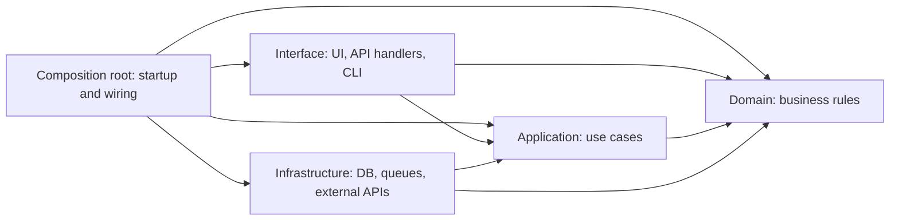
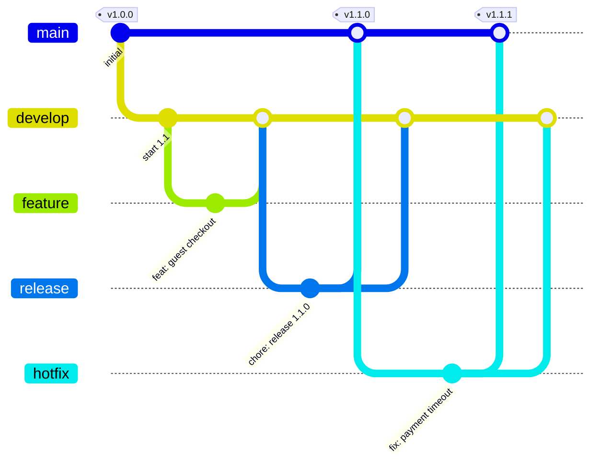

# Implementation Conventions

> Everything a developer or AI agent needs to make a correct change on day one.

## 1. Repo map
```
/src/…        ← what lives here
/tests/…      ← unit / integration split
/scripts/…    ← one-off and ops scripts
/kb/…         ← this knowledge base
```
Generated / do-not-edit paths: see [`AGENTS.md §3`](../../AGENTS.md).

## 2. Setup
Day-to-day commands (install, run, test, lint) are canonical in [`AGENTS.md §3`](../../AGENTS.md) — don't repeat them here. This section holds only what doesn't fit there:

- **Prerequisites (versions):** …
- **First-time setup** (accounts, local services, certificates): …
- **DB migrate / seed data:** …
- **Troubleshooting setup:** …

## 3. Code & architecture conventions

### 3.1 Standards we follow
> Adopt a named standard instead of inventing our own, and record only our choices and deviations here.
> A rule a tool enforces beats a rule in prose: fill in "Enforced by", or expect the rule to be ignored. Delete rows that don't apply.

| Area | Standard (default) | Our choices / deviations | Enforced by |
|---|---|---|---|
| Branching | [Gitflow](https://nvie.com/posts/a-successful-git-branching-model/) (classic): `main`, `develop`, `feature/*`, `release/*`, `hotfix/*` | see §5 | branch protection on `main` and `develop`: … |
| Commit messages | [Conventional Commits 1.0](https://www.conventionalcommits.org/en/v1.0.0/) | see §5 | commit-message lint in CI on every commit in a PR: … |
| Versioning | [Semantic Versioning 2.0](https://semver.org/) | | release tooling: … |
| Changelog | [Keep a Changelog](https://keepachangelog.com/) | `kb/07-status/changelog.md` | PR checklist |
| Formatting & lint | the language's standard formatter and linter: … | | CI lint step |
| Architecture | Clean (layered) architecture — rules in §3.2 | | import-boundary lint: … |
| API design | … (REST + OpenAPI 3 / GraphQL / gRPC) | | contract lint: … |
| Configuration | [Twelve-Factor](https://12factor.net/config): config from the environment, never in code | | … |
| Security | [OWASP Top 10](https://owasp.org/www-project-top-ten/) as the review baseline | | dependency + secret scanning: … |
| Accessibility | WCAG 2.2 AA | see `08-design/design-system.md` §8 | … |

### 3.2 Architecture rules
<!-- Clean-architecture defaults. Replace the layer names and paths with the real ones. Changing a rule here needs an ADR. -->
An arrow means "may depend on". Dependencies point inward, towards the business rules.



| Layer | Holds | Repo path | May import |
|---|---|---|---|
| Domain | entities, business rules | … | nothing outside itself — no framework, DB or HTTP code |
| Application | use cases, interfaces (ports) for what it needs from outside | … | Domain |
| Interface | UI, controllers, request/response mapping | … | Application, Domain types |
| Infrastructure | implementations of the ports: DB, queues, external APIs | … | Application, Domain |
| Composition root | startup code: builds the Infrastructure adapters, hands them to the use cases, registers the handlers (`main`, DI container, app bootstrap) | … | every layer — but it holds wiring only, no business logic |

1. **Dependencies point inward only.** Inner layers never import outer ones. Interface and Infrastructure never import each other; only the composition root sees both.
2. **Business rules live in Domain / Application** — never in handlers, UI components, or SQL.
3. **The outside world goes through an interface** (DB, HTTP, queues, clock, randomness) that the inner layer defines and Infrastructure implements. This is what makes the rules testable.
4. **Features don't reach into each other's internals** — use the other feature's public interface.
5. **No circular dependencies.**

### 3.3 Clean code rules
<!-- Only what the linter does NOT already enforce. Keep the ones you will actually hold reviews to. -->
- **Names** say what a thing is, using the words in [`glossary.md`](../01-context/glossary.md). Asset files (images, icons, fonts, exports) use lowercase words separated by hyphens — `login-flow.png`, not `Login flow.png`, `login_flow.png`, or `loginflow.png`.
- **Functions do one thing.** If describing it needs "and", split it.
- **Build only what the acceptance criteria need.** No speculative options or abstractions; extract shared code on the third use, not the first.
- **No dead code:** no commented-out code, no unused exports, no `TODO` without a ticket ID.
- **Comments explain why,** not what the code already says.
- **Errors** are never swallowed. How we raise, wrap and surface them: …
- **Logging:** what to log: … Never log PII or secrets.
- **Config** is read via `…`, never straight from the environment in business code.
- **Dependencies:** how to add one: … Banned: …
- **Refactors travel separately:** tidy the code you touch, but put it in its own `refactor:` commit, not mixed into a feature or fix.

## 4. Testing strategy
| Level | What it covers | Where | Must-have for |
|---|---|---|---|
| Unit | | | every PR |
| Integration | | | changes to DB / external calls |
| E2E | | | user-facing flows in REQ acceptance criteria |

## 5. Branching, commits, PRs, release

**Branching strategy:** [Gitflow](https://nvie.com/posts/a-successful-git-branching-model/) (classic). <!-- Changing the strategy needs an ADR. -->

| Branch | Purpose | Cut from | Merges into |
|---|---|---|---|
| `main` | production-ready code; every merge is a tagged release | — | — |
| `develop` | integration branch: everything finished for the next release | — | — |
| `feature/*` | one piece of work (new feature, non-urgent fix, chore) | `develop` | `develop` |
| `release/*` | release preparation: version bump, changelog, release fixes only | `develop` | `main` **and** `develop` |
| `hotfix/*` | emergency fix for production | `main` | `main` **and** `develop` — or, while a `release/*` branch is open, `main` **and** that release branch |



1. **`main` and `develop` are protected.** No direct pushes; every change arrives by PR with passing CI and an approval (§5.1). Never force-push either.
2. **Features:** cut `feature/*` from `develop`, one branch per source ID. Update it from `develop` at least daily and keep it short — a branch that lives for weeks is where merge pain comes from. Unfinished work that must merge goes behind a feature flag. Delete the branch after merging.
3. **Releases:** when `develop` holds everything for the release, cut `release/<version>`. From then on only release fixes, the version bump and the changelog go on it; new features keep going to `develop` for the next release. When it passes on staging, merge it into `main`, tag `vX.Y.Z` on `main`, deploy the tag, then merge the release branch back into `develop`.
4. **Hotfixes:** cut `hotfix/*` from `main`, fix, merge into `main`, tag a patch version, deploy. Then merge it back: into the open `release/*` branch if there is one (that release carries the fix into `develop` when it is merged back), otherwise into `develop`.
5. **Never skip the merge back.** A release or hotfix that is not merged back reappears as a bug in the next release. The work is not finished, and the branch is not deleted, until the back-merge is complete — an open PR is not enough.
6. **Merge method: always a merge commit** (`--no-ff`), never squash or rebase-merge. This applies to `feature/*` into `develop`, and to `release/*` and `hotfix/*` into `main`, `develop` or an open release branch. It keeps each feature's commits together under one merge, and gives the long-lived branches a shared history.
7. **Versions** follow SemVer and are decided when the release branch is cut, from the commit types merged since the last release (table below). Only `main` carries version tags.

**Branch protection on `main` and `develop`, enforced by:** … <!-- e.g. GitHub branch protection: require PR, 1 approval, passing checks, no force-push; restrict who can merge into main; repository set to allow merge commits only -->

**Branch names:**
- `feature/<source-id>-<slug>` — `feature/REQ-012-guest-checkout`, `feature/KI-007-export-timeout`, `feature/<ticket>-bump-deps`
- `release/<version>` — `release/1.3.0`
- `hotfix/<source-id>-<slug>` — `hotfix/INC-20261103-01-db-failover`

**Commits** follow [Conventional Commits](https://www.conventionalcommits.org/en/v1.0.0/):

```
<type>(<optional scope>): <summary: imperative, lower case, max 72 chars, no full stop>

<optional body: why the change was needed, not what the diff shows>

Refs: <source ID: REQ / RM for product work; INC, ticket or known issue (KI-nnn) for maintenance>
BREAKING CHANGE: <what breaks and how to migrate, only when it applies>
```

| Type | Use for | Version bump |
|---|---|---|
| `feat` | new behaviour a user or caller can see | minor |
| `fix` | bug fix | patch |
| `perf` | faster or lighter, same behaviour | patch |
| `refactor` | restructuring, same behaviour | none |
| `docs` | documentation only, including `kb/` | none |
| `test` | tests only | none |
| `build` / `ci` | build system, dependencies, pipelines | none |
| `chore` | anything else that doesn't touch behaviour | none |
| `revert` | undoing an earlier commit | as the original |

A `!` after the type (`feat!:`) or a `BREAKING CHANGE:` footer means a major bump.

Examples:
- `feat(checkout): add guest checkout` with `Refs: REQ-018`
- `fix(payments): retry webhook on timeout` with `Refs: INC-20261103-01`
- `docs(kb): update runbook RUN-004`

**Rules**
- One logical change per commit. KB updates go in the same PR as the code they describe.
- The PR title follows the commit **header** format (`<type>(<scope>): <summary>`), and the repository uses it as the merge commit's message, so merges read like the rest of the history.
- **Every commit lands on `develop`,** because features are merged, not squashed. So every commit on a `feature/*` branch follows the format above and carries the `Refs:` footer. Mark a breaking change on the commit that introduces it, with `!` in the header (`feat!:`) and a `BREAKING CHANGE:` footer.
- **Tidy before review:** fold "wip" and "fix typo" commits into the commits they belong to (rebasing your own unshared branch is fine) so the history that lands is worth keeping.
- A PR must pass CI, include the KB checklist, and meet the review rules in §5.1.
- Enforced by: … <!-- e.g. commitlint with @commitlint/config-conventional run on every commit in a PR, since all of them reach `develop`. A PR-title check alone only covers the merge commit's header. -->
- Release process: see `06-operations/environments.md`.

### 5.1 Review

- **Who approves a PR:** a named human other than its author, competent in the affected area. This applies to every PR, including KB-only and agent-authored ones. AI review is a useful first pass but is advisory: it never counts as approval.
- **One-person projects:** with no second human, the fallback is an AI review plus the author's own review against §6, and the PR says so. Switch to the rule above as soon as there is a second person.
- **Who else to include:** decision authority lives in [stakeholders](../01-context/stakeholders.md). Bring in the relevant decision owner when a change alters scope or design, and a reviewer competent in security or privacy when it affects those risks.
- **What the reviewer judges:** whether the evidence for the applicable §6 items is sufficient, whether the change stays in scope, follows the architecture rules (§3.2), and what could go wrong. Do the tests actually establish the claimed behaviour? For KB-only changes: is it accurate, and consistent with the rest of the KB? Leave anything CI enforces to CI.
- **Feedback** is labelled `blocking` (say which requirement is unmet, or what the risk is) or `suggestion` (optional). Blocking feedback is resolved before approval.
- **Record** the approval in the PR or a linked decision thread. A material change after approval needs re-review by the affected approver.
- **Approving a PR does not authorise running anything in production** — that follows the [change approval policy](../06-operations/environments.md#10-change-approval-policy).

## 6. Definition of Done
- [ ] Acceptance criteria in the REQ verified — or, for maintenance work with no REQ, the verification criteria recorded in its source (ticket / INC / known issue `KI-nnn`). Link the test or screenshot.
- [ ] UI changes compared with the design reference and viewports recorded in the REQ or the maintenance source, including each applicable state and keyboard use (or N/A — no UI)
- [ ] Tests added/updated and passing
- [ ] Observability: logs/metrics for the new path
- [ ] KB updated (see AGENTS.md §6)
- [ ] Ops informed if config, infra, or alerts changed

## 7. Common pitfalls
<!-- Hard-won lessons. "If you touch X, also update Y." These save the most AI-agent and new-hire time. -->
- …
